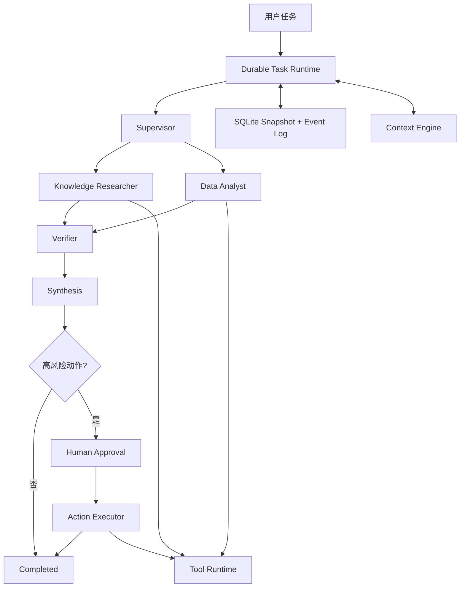
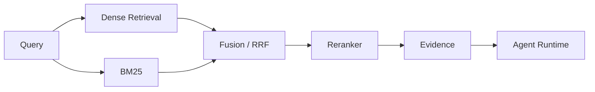

# Architecture

## 定位

Harness 控制单次任务如何推进；Agent Infra 提供任务跨进程、跨时间可靠运行所需的持久化、工具网关、可观测性和评测能力。

```text
Agent Layer
  Knowledge Researcher / Data Analyst / Verifier / Synthesis

Runtime Layer
  State Machine / Checkpoint / Event Store / Context Engine / Tool Runtime

Planned Platform Layer
  API / Scheduler / Trace / Evaluation / Fault Injection
```

## 当前数据流



## 模块边界

| 模块 | 职责 | 不负责 |
| --- | --- | --- |
| Runtime | 状态推进、checkpoint、resume、失败终止 | 业务领域推理 |
| Agent | 决策、分析、验证和合成 | 直接持久化共享状态 |
| Context | 模型可见上下文、压缩视图、token 预算 | 删除原始事件 |
| Tool Runtime | 白名单、风险边界、受控执行、幂等 | 自主规划 |
| Event Store | Snapshot、事件轨迹、乐观锁 | 判断业务结论 |
| Retrieval | 召回、融合、重排 | 业务写操作 |
| Evaluation | 数据集、指标、回归测试、故障注入 | 修改线上行为 |
| API | 会话、鉴权、流式返回 | Agent 内部推理 |

## 恢复原则

- 已写入 checkpoint 的阶段不重复执行。
- checkpoint 前中断的只读阶段允许 at-least-once 重跑。
- 写操作必须绑定具体 `action_id` 和人工审批。
- 写工具携带持久化 idempotency key，应对副作用成功但响应丢失。
- Snapshot 用于快速恢复，append-only Event Log 用于审计和解释。

详细语义见 [`docs/durable-runtime.md`](docs/durable-runtime.md)。

## 规划中的检索链路



## 待决策记录

每次关键选型记录：背景、候选方案、选择、证据、代价和复查时间。没有对比实验时，不预设 Multi-Agent、Planner 或某种检索策略一定更优。
