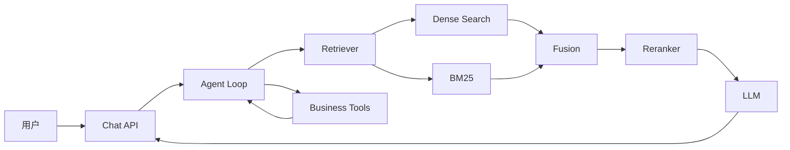

# Architecture

## 初始数据流

## 模块边界

| 模块 | 职责 | 不负责 |
| --- | --- | --- |
| Ingestion | 解析、切分、元数据、索引 | 生成答案 |
| Retrieval | 召回、融合、重排 | 业务写操作 |
| Agent | 决策、工具选择、状态推进 | 底层模型训练 |
| Tools | 参数校验和受控执行 | 自主规划 |
| Evaluation | 数据集、指标、回归测试 | 修改线上行为 |
| API | 会话、鉴权、流式返回 | 检索算法实现 |

## 待决策记录

每次关键选型记录：背景、候选方案、选择、证据、代价和复查时间。
