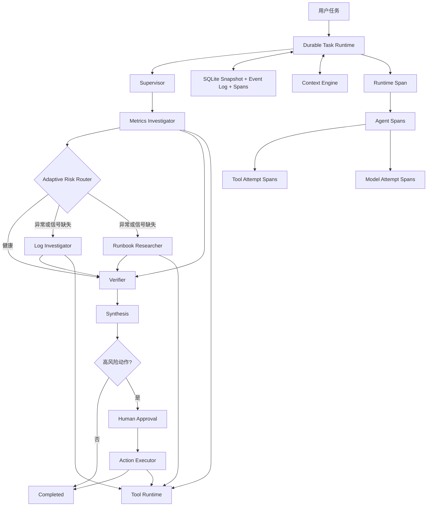
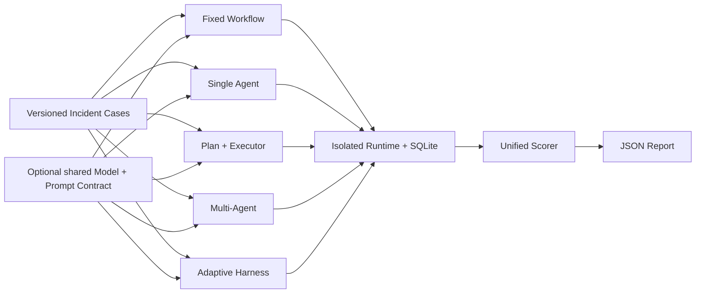
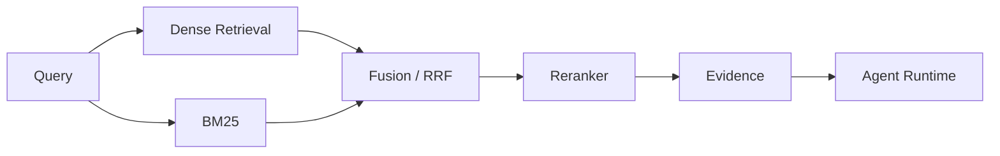

# Architecture

## 定位

Harness 控制单次任务如何推进；Agent Infra 提供任务跨进程、跨时间可靠运行所需的持久化、工具网关、可观测性和评测能力。

```text
Agent Layer
  Metrics Investigator / Log Investigator / Runbook Researcher / Verifier / Synthesis

Runtime Layer
  State Machine / Checkpoint / Event Store / Context Engine / Tool Runtime / Model Provider

Platform Layer
  Persistent Trace / Benchmark Runner / API (planned) / Scheduler (planned)
```

## 当前数据流



## 模块边界

| 模块 | 职责 | 不负责 |
| --- | --- | --- |
| Runtime | 状态推进、checkpoint、resume、失败终止 | 业务领域推理 |
| Risk Router | 根据已验证的结构化指标选择 triage 或完整验证链路 | 绕过 Verifier、审批或工具策略 |
| Agent | 决策、分析、验证和合成 | 直接持久化共享状态 |
| Context | 模型可见上下文、压缩视图、token 预算 | 删除原始事件 |
| Tool Gateway | Schema、白名单、审批、超时重试、限流、熔断、幂等 | 自主规划 |
| Model Provider | JSON 请求、重试、响应解析、usage 记录 | 改写已验证证据或执行工具 |
| Event Store | Snapshot、事件轨迹、乐观锁 | 判断业务结论 |
| Trace Recorder | Span 生命周期、父子关系、延迟与错误聚合 | 替代业务事件或完整日志正文 |
| Fault Injector | 在 provider adapter 边界复现瞬时、永久和超时故障 | 绕过 Gateway 策略 |
| Retrieval | 召回、融合、重排 | 业务写操作 |
| Evaluation | 数据集、指标、回归测试、故障注入 | 修改线上行为 |
| API | 会话、鉴权、流式返回 | Agent 内部推理 |

## 恢复原则

- 已写入 checkpoint 的阶段不重复执行。
- 编排模式和路由决定是任务快照的一部分；恢复时不重新解释 CLI 或重新路由。
- checkpoint 前中断的只读阶段允许 at-least-once 重跑。
- 写操作必须绑定具体 `action_id` 和人工审批。
- 写工具携带持久化 idempotency key，应对副作用成功但响应丢失。
- Snapshot 用于快速恢复，append-only Event Log 用于审计和解释。

详细语义见 [`docs/durable-runtime.md`](docs/durable-runtime.md)。

## Tool Gateway 调用顺序

```text
Allowlist
  -> Argument Schema
  -> Approval / Idempotency Policy
  -> Rate Limit
  -> Circuit Breaker
  -> Concurrency Slot
  -> Handler + Timeout
  -> Retry or Classified Failure
  -> ToolCallRecord
```

瞬时错误和超时允许按策略重试；永久错误、权限错误、参数错误和容量拒绝不会盲目重试。详细语义见 [`docs/tool-gateway.md`](docs/tool-gateway.md)。

## Trace 层级

```text
runtime.run / runtime.resume
  ├── agent.metrics_investigator
  │     └── tool.query_service_metrics
  ├── agent.risk_router
  ├── agent.log_investigator
  │     └── tool.search_logs
  ├── agent.runbook_researcher
  │     └── tool.get_runbook
  ├── agent.verifier
  ├── agent.incident_synthesis_agent
  │     └── model.deepseek.deepseek-v4-flash
  └── agent.action_executor
        └── tool.create_ticket
```

每个 Tool 重试 attempt 都是独立 Span，因此能区分“最终成功”与“前序尝试失败”。硬进程退出可能留下 `running` Span，查询汇总会单独报告，而不会将其伪装为成功。详细语义见 [`docs/observability.md`](docs/observability.md)。

## 评测隔离



每个 strategy × case × repetition 使用独立目录、Runtime 和 Model Provider，避免 rate limit、circuit breaker、fault counter、调用记录、ticket idempotency 和 Trace 相互污染。Model-backed 模式共享生产 Synthesis 合约，但不共享 Provider 实例；评分逻辑与策略实现分离，负样本必须安全拒绝才算任务成功。详细方法见 [`docs/benchmarking.md`](docs/benchmarking.md)。

## 规划中的检索链路



## 待决策记录

每次关键选型记录：背景、候选方案、选择、证据、代价和复查时间。没有对比实验时，不预设 Multi-Agent、Planner 或某种检索策略一定更优。
